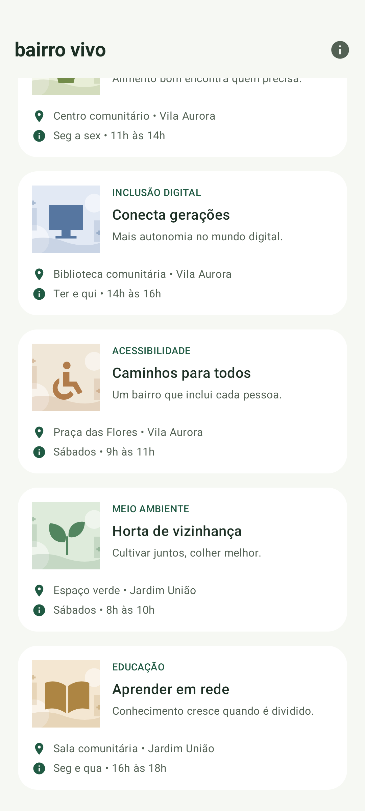
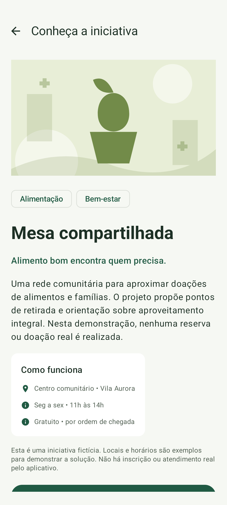

# Bairro Vivo

Aplicativo Android da Global Solution 2026, desenvolvido com **Kotlin, Jetpack Compose e Material Design 3**.

**Desenvolvedor:** Lucas Domingues — **RM 553304**.

## Tema e proposta

**CitizenTech: colocar o cidadão no centro da inovação.** O Bairro Vivo facilita a descoberta de iniciativas comunitárias de alimentação, educação, meio ambiente, acessibilidade, bem-estar e inclusão digital.

O problema proposto é a dificuldade de encontrar, em um único lugar, iniciativas do bairro e informações simples sobre participação. O público inicial são moradores e agentes comunitários. Essa necessidade é uma hipótese de produto a validar com entrevistas; não foi realizada pesquisa de campo neste projeto.

O MVP apresenta um catálogo offline, sem cadastro obrigatório e sem coleta de dados pessoais. Todos os nomes de iniciativas, locais, horários e descrições são **fictícios**, criados para demonstração acadêmica. O app não oferece reservas, inscrições ou atendimento real. Não usa localização nem estima distâncias.

### Conexão com os ODS

- **ODS 10:** facilitar a descoberta de oportunidades de inclusão e acessibilidade.
- **ODS 11:** dar visibilidade a iniciativas que fortalecem as comunidades.
- **ODS 4:** conectar moradores a oportunidades de educação e inclusão digital.

Essas contribuições são objetivos da proposta, não resultados de impacto já comprovados.

## Funcionalidades

- Catálogo com oito iniciativas em `LazyColumn`, construído com `items` e chaves estáveis.
- Seis categorias temáticas e a opção **Todas** em `LazyRow`.
- Seleção visual de categoria e filtragem automática por valores de `enum class`.
- Busca por título, resumo ou bairro, ignorando acentos e maiúsculas.
- Três destaques em outra `LazyRow`, derivados do atributo booleano dos mesmos objetos do catálogo.
- Detalhes com descrição, categorias, local, horário e condições de acesso.
- Estado vazio e botão para limpar filtros.
- Tela informativa sobre o projeto e os dados demonstrativos.
- Ilustrações vetoriais locais e funcionamento sem conexão com a internet.

Os destaques permanecem visíveis independentemente dos filtros; a seleção de categoria e a busca alteram a lista principal. O catálogo reinicia ao recriar a Activity, inclusive em mudanças de configuração; não há persistência de preferências nesta versão.

## Fluxo de telas

```text
Início
  ├── Buscar e/ou selecionar categoria → lista filtrada → abrir iniciativa
  ├── Abrir destaque → detalhes da mesma iniciativa
  └── Sobre → informações do projeto → fechar

Detalhes → botão Voltar ou gesto de retorno → Início
```

## Capturas reais

As imagens abaixo são capturadas no emulador Android a partir do próprio app.

| Início | Catálogo | Filtro |
|---|---|---|
|  |  |  |

| Detalhes | Busca sem resultados |
|---|---|
|  |  |

## Como executar

1. Abra esta pasta como projeto no Android Studio e aguarde a sincronização Gradle.
2. Use **JDK 17 ou 21** e instale o **Android SDK Platform 35** pelo SDK Manager.
3. O Android Studio configura `local.properties` com o caminho do seu SDK. Esse arquivo não deve ser versionado.
4. Execute o módulo `app` em um aparelho ou emulador com **Android 8.0/API 26 ou superior**.

Não há chaves de API, credenciais ou configuração de backend. A primeira compilação exige internet para baixar dependências; depois de instalado, o app funciona offline.

No Windows:

```powershell
.\gradlew.bat assembleDebug testDebugUnitTest lintDebug
.\gradlew.bat connectedDebugAndroidTest
```

O segundo comando exige um aparelho ou emulador conectado. O APK fica em `app/build/outputs/apk/debug/app-debug.apk`. É um APK de depuração, adequado à avaliação e demonstração.

### Versões fixadas

| Ferramenta | Versão |
|---|---|
| Android Gradle Plugin | 8.9.2 |
| Gradle Wrapper | 8.11.1 |
| Kotlin e plugin Compose | 2.1.20 |
| Compose BOM | 2025.04.01 |
| Activity Compose | 1.10.1 |
| compileSdk / targetSdk | 35 / 35 |
| minSdk | 26 |

A configuração do compilador Compose segue a [documentação Android](https://developer.android.com/develop/ui/compose/setup-compose-dependencies-and-compiler); a combinação AGP/Gradle segue as [notas do AGP 8.9](https://developer.android.com/build/releases/agp-8-9-0-release-notes).

## Arquitetura e origem dos dados

```text
app/src/main/java/br/com/bairrovivo/
├── MainActivity.kt                # ponto de entrada
├── model/
│   ├── Categoria.kt               # enum das categorias
│   └── Iniciativa.kt              # data class tipada
├── data/
│   └── IniciativaRepository.kt    # base em memória, busca e filtros
└── ui/
    ├── theme/Theme.kt             # cores Material 3
    ├── screens/
    │   ├── HomeScreen.kt          # estado e composição das listas
    │   └── DetailScreen.kt        # detalhes de uma iniciativa
    └── components/
        ├── IniciativaCard.kt      # registro e linha de informação
        ├── CategoriaChip.kt       # seleção reutilizável
        └── DestaqueCard.kt        # cartão horizontal
```

O repositório centraliza uma `List<Iniciativa>` e expõe `obterTodas`, `filtrar` e `obterDestaques`. A categoria é uma `enum class`; cada registro possui `List<Categoria>` e o booleano `destaque`. As regras de filtragem ficam no repositório, fora dos cartões de apresentação.

A tela principal usa `remember` e `mutableStateOf` para categoria, busca, detalhe selecionado e diálogo. A recomposição atualiza a lista automaticamente. Os cartões são composables sem estado próprio, recebem objetos e callbacks. `Scaffold`, `TopAppBar`, `Column`, `Row`, `Card`, `LazyColumn`, `LazyRow`, `Spacer`, `Text`, `Icon` e `Image` são usados na interface. XML é utilizado apenas para manifesto, tema de janela e recursos vetoriais; **nenhuma tela é construída em layout XML**.

A interface usa rolagem vertical, textos com quebra de linha, largura máxima em telas grandes, padding de barras do sistema e carrosséis horizontais. A aparência é clara nesta versão.

## Verificação

Os testes unitários verificam quantidade mínima de registros e destaques, IDs únicos, cobertura de categorias, objetos em múltiplas categorias, combinação de filtros e normalização da busca. Os testes instrumentados verificam catálogo, filtro, detalhes/retorno e busca vazia/limpeza. Consulte [VALIDACAO.md](docs/VALIDACAO.md) para os resultados efetivamente obtidos.

## Materiais e entrega

- [Requisitos e rastreabilidade](docs/REQUISITOS.md).
- [Documento de pitch e roteiro de gravação](docs/PITCH.md).
- [Documento de apoio ao pitch em PDF](docs/Pitch-Bairro-Vivo.pdf).
- Projeto completo com Gradle Wrapper e testes.

### Pendências externas

- Criar o repositório GitHub na conta do aluno, publicar o código e acrescentar o link à entrega.
- Gravar o vídeo com imagem e voz do aluno, publicar no YouTube com acesso público e acrescentar o link. O material de apoio não substitui essa gravação.
- Fazer a submissão no portal FIAP e conferir o ZIP enviado.

**Prazos divergentes nos enunciados:** o PDF específico de Android informa 19/09/2026 às 23h00. O documento geral informa período de 04/11 a 19/11/2026 e entrega do pitch em 19/11 às 23h55; também há um resumo mencionando 23h. Verifique a área de trabalhos e as orientações do professor para o prazo aplicável. Não foi feita submissão automática.
