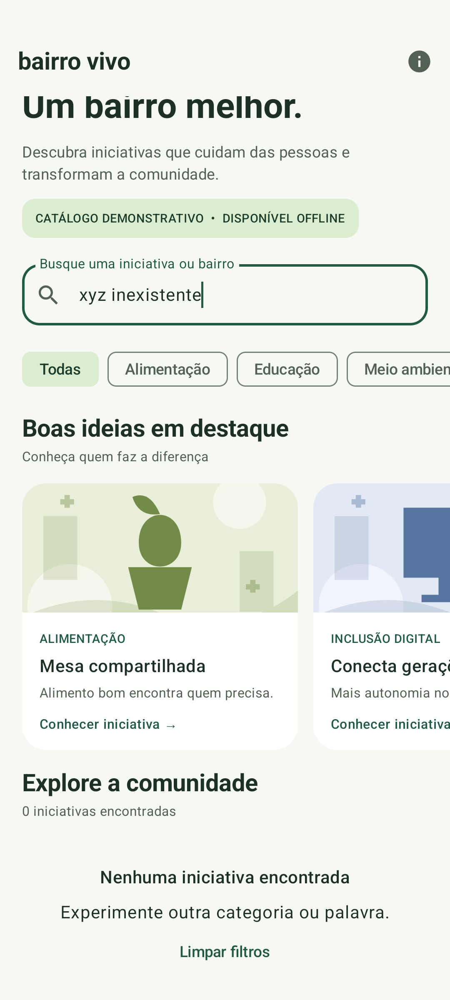

# Bairro Vivo

Aplicativo Android da Global Solution 2026, desenvolvido com **Kotlin, Jetpack Compose e Material Design 3**.

**Desenvolvedor:** Lucas Domingues — **RM 553304**.

## Tema e proposta

**CitizenTech: colocar o cidadão no centro da inovação.** O Bairro Vivo facilita a descoberta de iniciativas comunitárias de alimentação, educação, meio ambiente, acessibilidade, bem-estar e inclusão digital.

O problema proposto é a dificuldade de encontrar, em um único lugar, iniciativas do bairro e informações simples sobre participação. O público inicial são moradores e agentes comunitários. Essa necessidade é uma hipótese de produto a validar com entrevistas; não foi realizada pesquisa de campo neste projeto.

O MVP apresenta um catálogo offline, sem cadastro obrigatório e sem coleta de dados pessoais. Todos os nomes de iniciativas, locais, horários e descrições são **fictícios**, criados para demonstração acadêmica. O app não oferece reservas, inscrições ou atendimento real. Não usa localização nem estima distâncias.


## Funcionalidades

- Catálogo com oito iniciativas em `LazyColumn`, construído com `items` e chaves estáveis.
- Seis categorias temáticas e a opção **Todas** em `LazyRow`.
- Seleção visual de categoria e filtragem automática por valores de `enum class`.
- Busca por título, resumo ou bairro, ignorando acentos e maiúsculas.
- Três destaques em outra `LazyRow`, derivados do atributo booleano dos mesmos objetos do catálogo.
- Detalhes com descrição, categorias, local, horário e condições de acesso.
- Estado vazio e botão para limpar filtros.
- Tela informativa sobre o projeto e os dados demonstrativos.
- Ilustrações vetoriais locais e funcionamento sem conexão com a internet.

Os destaques permanecem visíveis independentemente dos filtros; a seleção de categoria e a busca alteram a lista principal. O catálogo reinicia ao recriar a Activity, inclusive em mudanças de configuração; não há persistência de preferências nesta versão.

## Fluxo de telas

```text
Início
  ├── Buscar e/ou selecionar categoria → lista filtrada → abrir iniciativa
  ├── Abrir destaque → detalhes da mesma iniciativa
  └── Sobre → informações do projeto → fechar

Detalhes → botão Voltar ou gesto de retorno → Início
```

## Capturas reais

As imagens abaixo são capturadas no emulador Android a partir do próprio app.

| Início | Catálogo | Filtro |
|---|---|---|
|  |  |  |

| Detalhes | Busca sem resultados |
|---|---|
|  |  |


## Arquitetura e origem dos dados

```text
app/src/main/java/br/com/bairrovivo/
├── MainActivity.kt                # ponto de entrada
├── model/
│   ├── Categoria.kt               # enum das categorias
│   └── Iniciativa.kt              # data class tipada
├── data/
│   └── IniciativaRepository.kt    # base em memória, busca e filtros
└── ui/
    ├── theme/Theme.kt             # cores Material 3
    ├── screens/
    │   ├── HomeScreen.kt          # estado e composição das listas
    │   └── DetailScreen.kt        # detalhes de uma iniciativa
    └── components/
        ├── IniciativaCard.kt      # registro e linha de informação
        ├── CategoriaChip.kt       # seleção reutilizável
        └── DestaqueCard.kt        # cartão horizontal
```

O repositório centraliza uma `List<Iniciativa>` e expõe `obterTodas`, `filtrar` e `obterDestaques`. A categoria é uma `enum class`; cada registro possui `List<Categoria>` e o booleano `destaque`. As regras de filtragem ficam no repositório, fora dos cartões de apresentação.

A tela principal usa `remember` e `mutableStateOf` para categoria, busca, detalhe selecionado e diálogo. A recomposição atualiza a lista automaticamente. Os cartões são composables sem estado próprio, recebem objetos e callbacks. `Scaffold`, `TopAppBar`, `Column`, `Row`, `Card`, `LazyColumn`, `LazyRow`, `Spacer`, `Text`, `Icon` e `Image` são usados na interface. XML é utilizado apenas para manifesto, tema de janela e recursos vetoriais; **nenhuma tela é construída em layout XML**.

A interface usa rolagem vertical, textos com quebra de linha, largura máxima em telas grandes, padding de barras do sistema e carrosséis horizontais. A aparência é clara nesta versão.

